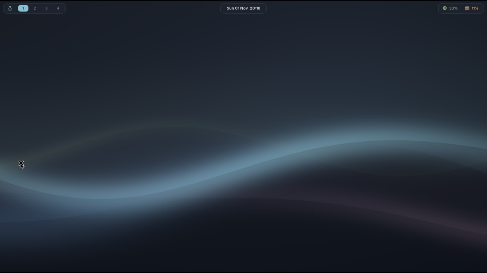
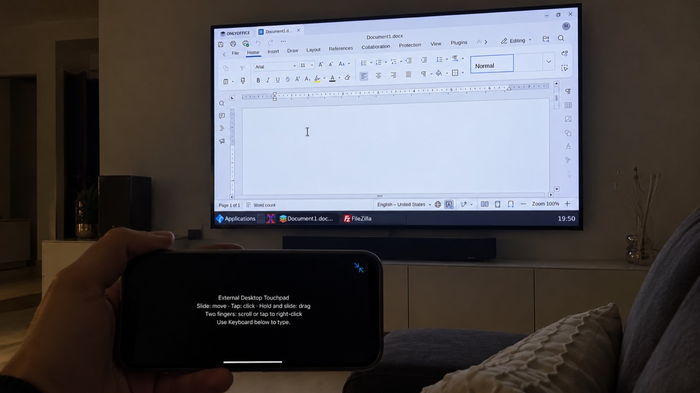
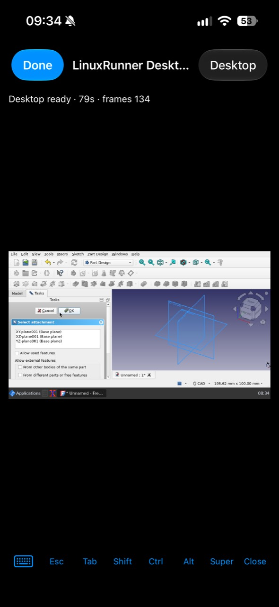
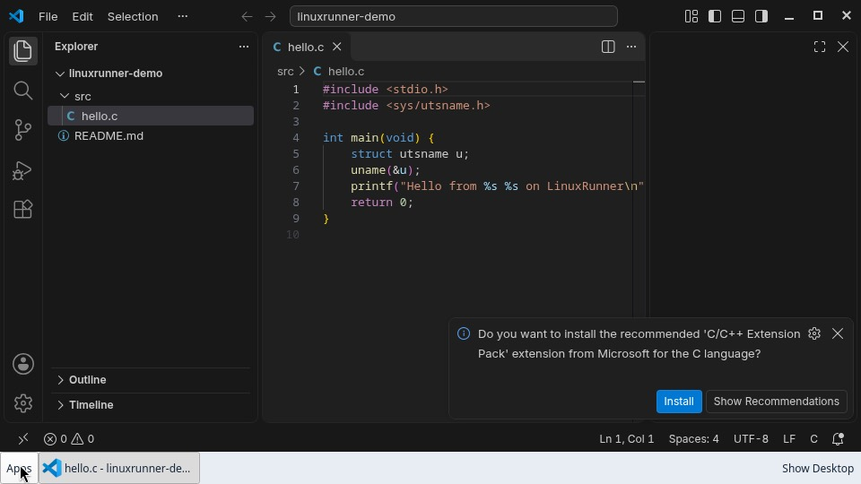
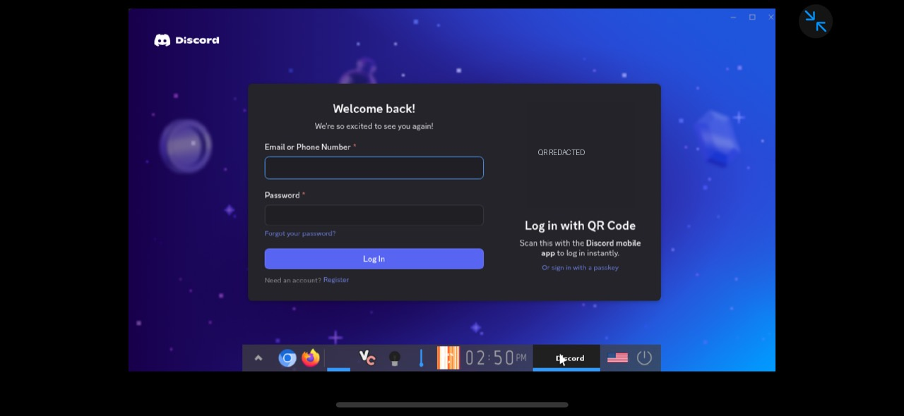
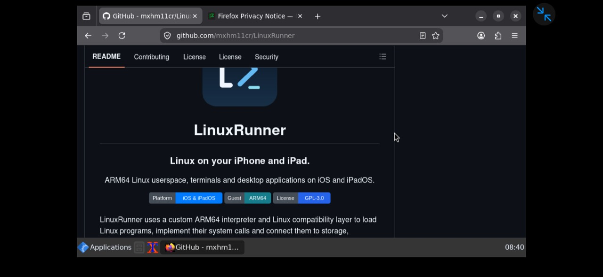
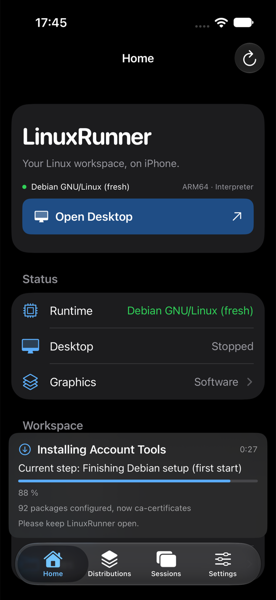
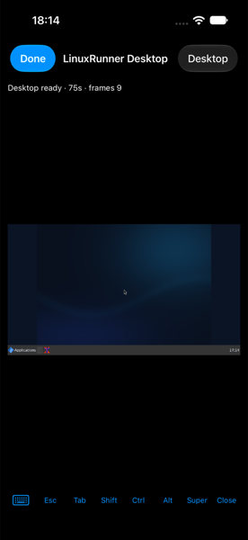

<p align="center">
  
</p>
<h1 align="center">LinuxRunner</h1>
<h2 align="center">Your iPhone. A Real Linux PC.</h2>
<p align="center">ARM64 Linux applications. Full desktop environments. A workspace on an external display.</p>
<p align="center">
  
  
  <a href="LICENSE.md"></a>
</p>
<p align="center">
  <a href="https://github.com/mxhm11cr/LinuxRunner/releases">Download</a> ·
  <a href="#getting-started">Get started</a> ·
  <a href="docs/releases/v1.1.0.md">What's new in 1.1.0</a> ·
  <a href="docs/TROUBLESHOOTING.md">Help</a>
</p>

LinuxRunner brings ARM64 Linux userspace to iPhone and iPad through a custom instruction interpreter, an optional JIT engine and a Linux compatibility layer. Run Linux applications, explore desktop environments and take your workspace to an external display.

**No jailbreak. JIT is optional.** LinuxRunner executes Linux userspace programs; it does not boot a Linux kernel or use a full-system virtual machine.

[](assets/screenshots/desktop/hyprland-metal.jpg)

**Hyprland · Experimental** — Metal GPU acceleration. Requires at least 8 GB RAM and Arch Linux ARM.

[](assets/screenshots/linuxrunner-dolphin.png)

**KDE Plasma** — an experimental desktop option on Debian.

## Your iPhone. Your Desktop.

[](assets/screenshots/desktop/dex-external-display.jpg)

**DeX Mode** brings the Linux desktop to a compatible external display. Use a keyboard and mouse, or turn the iPhone into a touchpad. This is LinuxRunner's own desktop integration and ARM64 runtime; Android and Samsung DeX are not involved.

1. Connect a compatible display using an adapter/cable supported by your device. For AirPlay, connect to a compatible receiver through **iOS Control Center → Screen Mirroring**.
2. Enable **Settings → Devices → External Desktop Output**.
3. Choose **Home → Open Desktop** (or **Resume Desktop**).
4. In the viewer, open **Desktop → Use iPhone as Trackpad**. Controls become available when a separate external scene and desktop frame are ready.
5. Slide to move, tap to click, hold and slide to drag. Use two fingers to scroll or tap for right click. The keyboard button opens typing controls; compatible hardware input is forwarded through iOS.

Use **Desktop → Desktop Settings… → Display** for scaling and **Resolution & Viewer Preferences**. Guest resolution changes apply at the next desktop start; viewer scaling changes immediately. The default desktop size is 960 × 540.

AirPlay receiver behavior varies. Plain screen mirroring shows the same image and cannot provide an independent phone control surface. This is one Linux desktop output, not multiple extended guest monitors. Miracast-only receivers are unsupported. [Display and input guide](docs/NETWORKING_AND_DISPLAYS.md)

## Inside 1.1.0

| Capability | What it brings |
| --- | --- |
| **Linux desktops** | LinuxRunner Desktop, LXQt, Enlightenment and experimental Wayland/Plasma options. |
| **Metal graphics** | A virtual Linux GPU connects compatible Mesa workloads to Apple's GPU. |
| **Optional ARM64 JIT** | An additional execution path when the device permits it; the interpreter remains available. |
| **Faster interpreter** | NEON, memory and atomic-operation improvements, plus instruction correctness fixes. |
| **Linux applications** | Package managers, developer tools, office software, communication apps and more. Compatibility varies. |
| **Files and networking** | Import/export, per-environment shared folders, sockets, interface and route reporting. |
| **Three distributions** | Debian ARM64, Arch Linux ARM and Alpine ARM64, with separate environments and Linux accounts. |

## Supported Devices and Requirements

LinuxRunner supports ARM64 iPhone and iPad layouts, touch input, hardware keyboards and compatible pointers. **iPad support has been physically tested by the maintainer.** Its larger window gives terminals and Linux applications more room; viewer sizing, rotation and keyboard shortcuts are supported.

| | Minimum guidance | Recommended |
| --- | --- | --- |
| Device | iPhone 11 or newer, or an equivalent compatible iPad/device | iPhone 12 Pro or newer, or a compatible device with more memory |
| RAM | At least 4 GB | At least 6 GB |
| OS | iOS/iPadOS 15.0 deployment target; see caveat below | iOS/iPadOS 26 or newer, preferably a recently tested version |
| Free storage | Approximately 3–4 GB for basic use | At least 10 GB for desktops and larger applications |

**iOS 15 is an intended compatibility target, not broadly verified support.** Development and device testing have primarily used much newer releases. Older versions can have limitations or startup problems; an earlier iPhone 11/iOS 17 black-screen report remains unresolved. These are workload guidelines, not certification of every model. Large installations can need substantially more than 10 GB.

**Hyprland requires at least 8 GB RAM.** It remains experimental and is still being optimized; Metal is recommended. [Compatibility details](docs/COMPATIBILITY.md)

## Supported Linux Distributions

| Distribution | Packages | Desktop experience |
| --- | --- | --- |
| **Debian GNU/Linux 13 ARM64** | `apt`, `dpkg` | Recommended. LinuxRunner Desktop, LXQt; experimental KDE Plasma and Wayfire. |
| **Arch Linux ARM** | `pacman` | Recommended for newer desktop/application packages. LinuxRunner Desktop, LXQt, Enlightenment, Wayfire and experimental Hyprland. |
| **Alpine Linux 3.24 ARM64** | `apk` | Small terminal environment; desktop and application coverage is more limited. |

Debian or Arch is recommended for desktop use. Alpine remains supported, with further compatibility and desktop integration work planned. Additional distribution support is planned. Multiple environments can coexist; one runtime is active per app launch.

## Installation

1. Download the LinuxRunner IPA from [GitHub Releases](https://github.com/mxhm11cr/LinuxRunner/releases).
2. Install it using a compatible IPA sideloading tool of your choice, such as Sideloadly or AltStore Classic.
3. Open LinuxRunner on your iPhone or iPad.
4. Follow **Set Up Linux…** to install Linux inside the app.

The IPA needs signing/provisioning appropriate to your installation method. Tool compatibility, account requirements and signing renewal vary. **JIT is not required to install or use LinuxRunner.** Back up important files before updating and preserve the existing app identity and storage configuration. [Signing and download verification](docs/INSTALLATION.md)

## Getting Started

Installing the IPA installs the app. **Installing a Linux distribution is a separate step inside LinuxRunner.**

1. Open **Distributions → Set Up Linux… → Continue**.
2. On **Choose Linux**, select Debian or Arch for desktop use, or Alpine for a small terminal environment.
3. Continue to **Install Linux**, review storage/download information and select the distribution's install button.
4. Keep the app open while setup prepares the root filesystem. Follow **Restart LinuxRunner** if requested; setup resumes after reopening.
5. On **Your Account**, create or select a regular Linux user. Enable **Administrator (can use sudo)** if you want to install packages.
6. Install **Desktop Components** when offered, or use **Later** for terminal-only use. A desktop is optional.
7. On Home, choose **Terminal** or **Open Desktop**. **Resume Desktop** reconnects to an existing session.
8. Optionally choose another desktop in Settings, enable Metal, or configure external output. Configure JIT only if you want to experiment with it.

Try `cat /etc/os-release` and `uname -m` in the terminal. Install Linux applications through **App Manager** or your distribution's package manager. Package availability does not guarantee compatibility.

[Full setup walkthrough, account options and package commands](docs/GETTING_STARTED.md)

## Choose Your Desktop

Open **Settings → Desktop Environment**. Select the relevant **Install…** button, wait for completion, then choose the installed environment in the **Desktop** picker under **Open Desktop Starts**. Save your work and stop any running desktop before switching. Return to Home and select **Open Desktop**.

| Desktop | Availability and status |
| --- | --- |
| **LinuxRunner Desktop** | Lightweight Openbox-based default and fallback; panel and file manager. |
| **LXQt** | X11 desktop with LXQt panel, PCManFM-Qt, QTerminal and Openbox; prefer Debian or Arch. |
| **Enlightenment** | Available on Arch. Disabled on Debian because startup currently stops at the splash screen. |
| **Wayfire** | Experimental Wayland compositor on Debian/Arch; GPU integration is available on Arch. |
| **Hyprland** | **Experimental, Arch only, at least 8 GB RAM. Metal recommended.** |
| **KDE Plasma** | Experimental Debian X11 session with Dolphin and Konsole. Arch Plasma is not validated. |

Hyprland is still undergoing optimization. Its first launch can occasionally report an error; select **Retry** if offered. This known startup issue is planned for improvement. Use LinuxRunner Desktop or LXQt if it persists. [Desktop controls and recovery](docs/DESKTOP_CONTROLS.md)

## Real GPU Acceleration. Powered by Metal.

Compatible Linux graphics workloads can use this path:

**Linux graphics APIs → guest Mesa/virgl → virglrenderer → ANGLE → Apple Metal**

This lets supported Linux applications and compositors use the Apple GPU. It is separate from simply presenting the viewer with Metal, and does not accelerate every application or graphics API.

**Select Metal explicitly:** open **Settings → Graphics → Linux GPU Device → GPU → Metal GPU · Experimental**. Fully close and reopen LinuxRunner, then check **Active renderer** on the same page. **Automatic** does not select this accelerated path in Build 900. **Software Rendering** remains available for compatibility and can be considerably slower for demanding graphics.

<p align="center"><a href="assets/screenshots/applications/freecad-metal-iphone.jpg"></a></p>

**FreeCAD** — captured with Metal GPU selected.

**Physical-iPhone result:** the maintainer reports about **10 FPS with software rendering** and **55–60 FPS with Metal** on an **iPhone 16 Pro running iOS 27.2** during **Hyprland** testing. This is a reported observation, not a controlled benchmark; the counter/method and duration were not supplied. The Hyprland and FreeCAD captures also use GPU acceleration. The maintainer reports higher rates on other desktops; results vary by workload and presentation path. [Performance details](docs/PERFORMANCE.md)

## JIT When You Want It. Interpreter When You Don’t.

**JIT is not required to use LinuxRunner.** The ARM64 interpreter is the default execution path and works without enabling JIT. The optional JIT translates supported guest blocks into host instructions when the platform grants executable memory.

To inspect it, enable **Settings → Advanced → Developer Mode**, then open **Execution Engine / StikDebug**. The page shows **JIT Status**, the running backend and translated-block counts. Choose **Interpreter**, **Automatic** or **JIT** as appropriate. **Attach with StikDebug** and **Activate JIT Now** are experimental activation controls, not a guarantee that iOS will permit JIT.

Availability depends on OS restrictions, signing and the activation method. If permission is unavailable, LinuxRunner continues through the interpreter. JIT can benefit longer compute workloads while translation overhead can make short programs slower. [Execution details](docs/engine/IOS_JIT.md)

## A Better ARM64 Runtime

Version 1.1.0 improves NEON comparisons/pairwise operations, exclusive-store handling and dirty-page filtering. It adds JIT translations for ARMv8 AES and SHA instructions, advertises validated PMULL/SHA1/SHA2/CRC32 capabilities, and fixes vector RBIT and JIT memory-offset correctness. These changes reduce covered instruction failures and improve execution for compatible software.

[Recorded interpreter and JIT comparisons](docs/PERFORMANCE.md) include workload details, ranges and cases where JIT translation overhead is slower.

## More Linux Apps. More Possibilities.

<table>
<tr>
<td align="center"><a href="assets/screenshots/applications/vscode.jpg"></a><br><b>Visual Studio Code</b></td>
<td align="center"><a href="assets/screenshots/applications/vesktop-redacted.png"></a><br><b>Vesktop / Discord</b></td>
</tr>
<tr>
<td align="center"><a href="assets/screenshots/applications/firefox-github.jpg"></a><br><b>Firefox</b></td>
<td align="center"><a href="assets/screenshots/linuxrunner-blender-viewport.jpg"></a><br><b>Blender</b></td>
</tr>
</table>

Firefox, VS Code, FreeCAD, ONLYOFFICE, Blender and Dolphin are among the apps running in LinuxRunner. Vesktop works too, and Telegram on Arch supports login, messaging and calls.

[Application compatibility and test scope](docs/COMPATIBILITY.md)

## Networking and Files

Linux sockets use the device's available network connection. Build 900 improves address, interface and routing reporting through Linux-compatible queries:

```sh
ip addr
ip link
ip route
```

These describe the network information LinuxRunner can obtain through iOS APIs and its compatibility layer. They do not give Linux programs unrestricted access to radios, raw packets or host routing controls. **Bluetooth networking is not supported.**

Use **Settings → File Sharing** to import/export files or access the active environment's shared folder at `/mnt/LinuxRunnerShared`. A `~/Shared` link is created when that name is available. [Files](docs/FILE_SHARING.md) · [Networking](docs/NETWORKING_AND_DISPLAYS.md)

<details>
<summary><b>More from LinuxRunner: interface, setup and Arch</b></summary>

<table>
<tr>
<td align="center"><br><b>Home</b></td>
<td align="center"><br><b>Settings</b></td>
</tr>
<tr>
<td align="center"><br><b>Installing Linux</b></td>
<td align="center"><br><b>Desktop viewer</b></td>
</tr>
<tr>
<td align="center" colspan="2"><br><b>Telegram Desktop</b></td>
</tr>
</table>

The existing image collection remains available in [screenshots](assets/screenshots/README.md). Older interface captures illustrate the workflow; labels in the current guides describe Build 900.

</details>

## How LinuxRunner Works

1. The loader maps ARM64 Linux ELF executables and shared libraries.
2. The interpreter executes supported ARM64 instructions; the optional JIT translates blocks when permitted.
3. The compatibility layer implements Linux system calls, process/thread behavior, signals, memory mappings and filesystem metadata.
4. Each environment supplies its own guest filesystem and Linux packages; sockets use host networking APIs.
5. X11 sessions use Xvfb/x11vnc. Supported Wayland compositors run against LinuxRunner's virtual display/GPU devices, with display and input forwarded into the app's viewer and external scene.

This combines **instruction interpretation/translation and userspace compatibility**. It is not hardware virtualization or full-system kernel emulation. [Architecture](docs/ARCHITECTURE.md)

## Compatibility and Limitations

- ARM64 userspace only; no x86 applications, Linux kernel boot, kernel modules or general systemd-as-init/container support.
- Syscall, graphics and application coverage remains incomplete. Large desktops can exceed device memory or thermal limits.
- Hyprland, Wayfire, KDE Plasma and the Metal backend have experimental paths; desktop/distribution combinations differ.
- JIT depends on platform permissions; software rendering and interpreter execution remain available.
- iOS/iPadOS can suspend or terminate LinuxRunner. **Done** leaves a session running in the app; app termination ends running Linux processes. Saved files persist.
- Guest accounts and permissions are compatibility features, not a security boundary for untrusted software.

[Compatibility](docs/COMPATIBILITY.md) · [Known limitations](docs/KNOWN_LIMITATIONS.md) · [Security](SECURITY.md)

## Troubleshooting and Contributing

Use [Troubleshooting](docs/TROUBLESHOOTING.md) before reinstalling an environment. **App Manager → Repair Center** offers diagnostics and package repair. **Settings → Advanced → Export Open Desktop Report** collects session information; inspect logs for personal data before sharing.

[Report an issue](https://github.com/mxhm11cr/LinuxRunner/issues/new/choose) with your device, OS, version/build, distribution, desktop, graphics/backend status and reproducible steps. Contributions and scoped compatibility reports are welcome: [Contributing](CONTRIBUTING.md).

## Build from Source

Most users install the IPA. Developers should follow [Building](docs/BUILDING.md), including the additional pinned graphics dependencies for the Metal-enabled variant. The build remains **1.1.0 (900)** with bundle identifier `dev.linuxrunner.app`.

## License and Acknowledgments

Maintained by **Leminos ([mxhm11cr](https://github.com/mxhm11cr))**. LinuxRunner derives from [iSH](https://github.com/ish-app/ish), by Theodore Dubois and contributors, through [ios-linuxkit](https://github.com/rcarmo/ios-linuxkit), by Rui Carmo and contributors.

The combined application is GPL-3.0-covered. Preserve upstream contribution-specific terms, attribution and the App Store terms in [LICENSE.md](LICENSE.md) and [LICENSE.IOS](LICENSE.IOS). Graphics, terminals, fonts, Linux distributions, desktops and applications retain their own licenses and authorship. In particular, Metal integration uses Mesa/virgl, virglrenderer, libepoxy and ANGLE. [Third-party notices](THIRD_PARTY_NOTICES.md)
